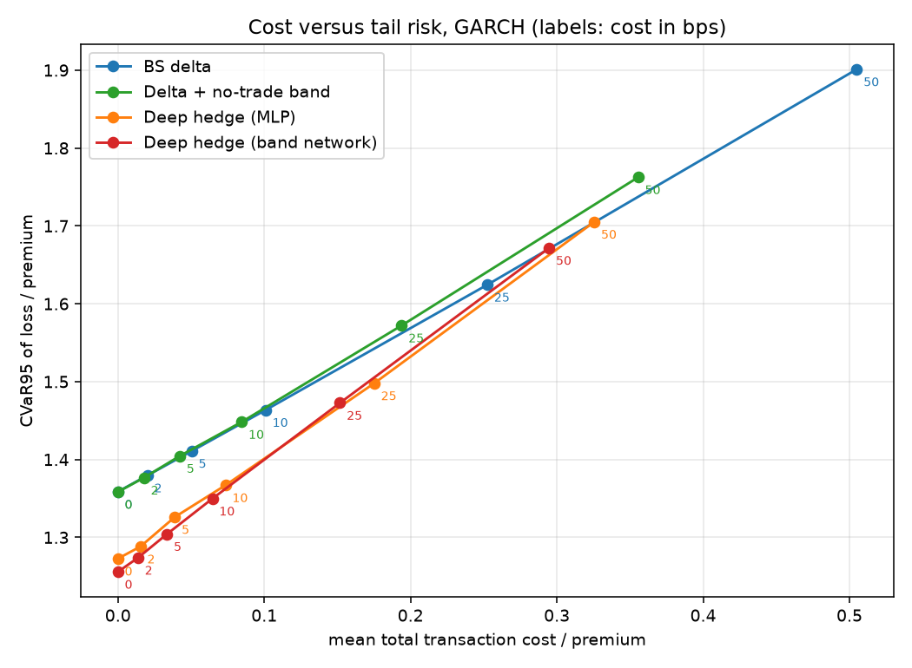
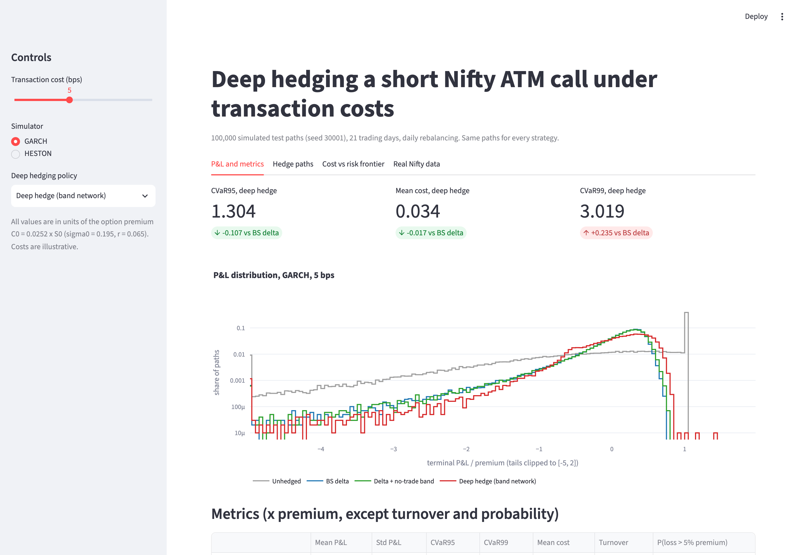
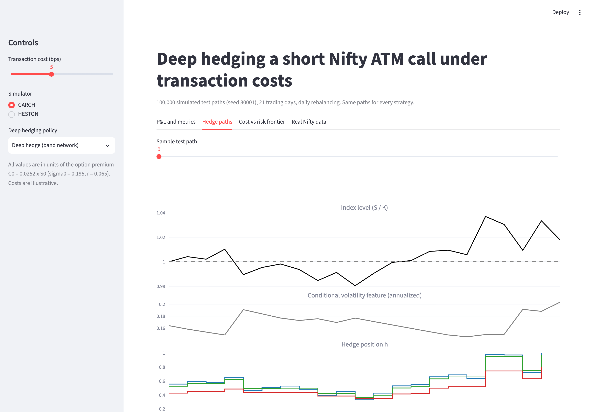
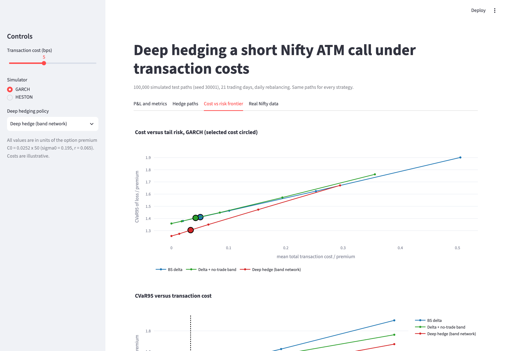
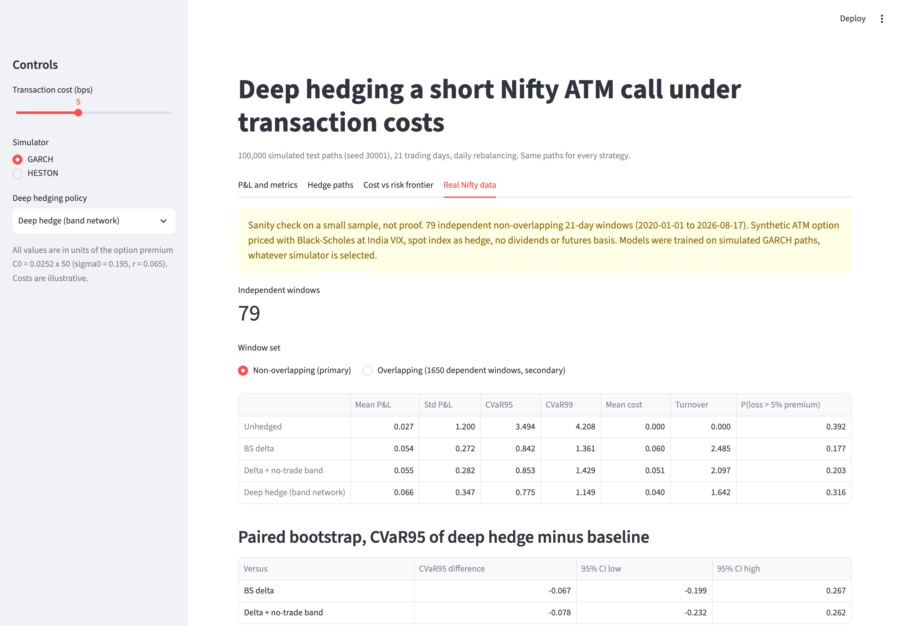

# deep-hedging-nifty

Deep hedging of a short Nifty 50 at-the-money call under proportional transaction costs. A neural policy is trained to minimise CVaR95 of the hedging loss on simulated Nifty paths, then compared with Black-Scholes delta hedging, a tuned no-trade-band delta hedge and no hedge, on 100,000 simulated test paths and on real Nifty history since 2020.

**Headline result (GJR-GARCH simulator, 100,000 test paths, same paths for every strategy).** At the default 5 bps cost, the no-transaction-band network cuts CVaR95 of the loss from 1.411 to 1.304 premiums (−7.6%) and mean trading cost from 0.051 to 0.034 premiums (−34%) compared with daily BS delta hedging. At 50 bps the CVaR95 gap widens to 1.672 against 1.901 premiums (−12.1%) and costs fall from 0.505 to 0.295 premiums (−42%). Every paired-bootstrap 95% interval for the CVaR95 difference excludes zero, against both BS delta and the tuned band baseline. The price of this is a fatter extreme tail: std and CVaR99 are worse than BS delta on GARCH (see [Results](#results) and [Known limitations](#known-limitations)). On 79 independent windows of real Nifty data, the point estimates favour the deep hedges, but no interval excludes zero.

One premium here is C0 = 0.0252 S0, the BS price of the 21-day ATM call at the fitted unconditional volatility of 19.5% and r = 6.5%. With Nifty at 22,422 (close on 2026-10-01), one premium is about 566 index points.



## Dashboard

```bash
streamlit run app/dashboard.py
```

| P&L and metrics | Hedge paths | Frontier | Real data |
|---|---|---|---|
|  |  |  |  |


The sidebar has a transaction-cost slider over the cost grid (0, 2, 5, 10, 25 and 50 bps), a simulator selector (GARCH or Heston) and a deep-policy selector (band network or MLP). Every view updates with the slider. The dashboard only reads precomputed files from `data/processed/dashboard/`; nothing is trained at runtime.

## How it works

### Option and hedging setup
- Short one ATM European call, K = S0, 21 trading days, dt = 1/252, cash settled. Prices are normalised to S0 = K = 1 inside every model.
- Every strategy receives the same premium C0 = BS(sigma0, r), with sigma0 = 19.53% (the fitted GARCH unconditional volatility) and r = 6.5%.
- At each day t_k the strategy chooses a position h_k in [0, 1] in the index (a proxy for futures), using only information at t_k. Trading costs c S_k |h_k − h_{k−1}| with c = cost_bps / 10,000, and the final position is unwound at expiry at cost c S_N h_{N−1}. Cash accrues at r.
- Terminal P&L = cash_N + h_{N−1} S_N − unwind cost − max(S_N − K, 0). The loss is L = −P&L.

### Why Black-Scholes delta breaks under costs
BS delta is the variance-minimising hedge only with continuous trading, constant volatility and no costs. With daily trading and proportional costs, it chases every small move in delta and pays the cost each time: its expected cost grows linearly in c while the risk it removes does not change. It also assumes constant, symmetric volatility, while Nifty volatility clusters and rises after falls. A no-trade band around delta fixes the first problem crudely; deep hedging learns both the band and the state dependence directly from the objective.

### Deep hedging
Following Buehler, Gonon, Teichmann and Wood (2019), the hedge is a neural network applied recurrently along the path, trained end to end through the P&L accounting to minimise a risk measure of the terminal loss. Training uses fresh simulated paths every epoch (50,000 per epoch), Adam, gradient clipping, a plateau learning-rate schedule and early stopping on a fixed 20,000-path validation set. Test paths (100,000, fixed seed) are never used for training or model selection.

### Architectures
- **MLPPolicy**: inputs [t/T, ln(S/K) / (sigma0 sqrt T), h_prev, ln(sigma_t / sigma0), BS delta, running P&L]; 3 hidden layers of 64 with ReLU; sigmoid output in [0, 1]. h_prev is fed back step by step.
- **NoTransactionBandPolicy** (after Imaki et al. 2021): the network outputs a correction to BS delta and two softplus half-widths. The position is h_prev clamped into [reference − lower width, reference + upper width], so the policy does not trade at all while inside its band.
- sigma_t is the one-step-ahead GARCH conditional volatility (Heston: sqrt(v_t)). The running P&L is (cash + h_prev S − BS call value) / premium. Inputs are clipped to fixed ranges ([−5, 5], and [−2, 2] for log volatility) so the networks cannot extrapolate in states they have rarely seen.

### Loss
CVaR at alpha = 0.95 via Rockafellar-Uryasev: CVaR = w + mean(relu(L − w)) / (1 − alpha), with w a learnable scalar trained jointly with the network. Evaluation uses an exact sort-based CVaR (mean of the worst ceil(n (1 − alpha)) losses); a unit test checks that the two agree.

### Market simulators
- **GJR-GARCH(1,1) with Student-t innovations**, fitted with `arch` on Nifty daily log returns from 2007-09-18 to 2019-12-31 only (3,000 returns). Fitted: mu = 0.041%, omega = 0.0168, alpha = 0.011, gamma = 0.129, beta = 0.913, nu = 8.6 (persistence 0.989, unconditional vol 19.5%). Paths are generated by a vectorised NumPy recursion after a 250-day burn-in, so the starting volatility varies across paths. The recursion reproduces `arch`'s own simulated volatility path to 3e-16; mean, std, quantiles and ACFs of absolute and squared returns match `arch` simulations. With these parameters the unconditional fourth moment is infinite, so kurtosis is reported but not compared.
- **Heston** (full-truncation Euler, 4 sub-steps per day) with **illustrative parameters, not calibrated to the option surface**: theta = v0 = pre-2020 realised variance (21.9% vol), kappa = 3, xi = 0.4, rho = −0.7, drift = r.
- **GBM**, used only for the two validation checkpoints.

### Validation gates
- **Checkpoint A** ([report](results/validation/rebalance_scaling.md)): BS delta under GBM with c = 0, rebalanced n = 1 to 84 times on the same 50,000 paths. Std falls monotonically, from 0.0157 to 0.0020; std x sqrt(n) stays within 7.1% of its median; |mean| / std < 0.006. **PASS.**
- **Checkpoint B** ([report](results/validation/gbm_validation.md)): an MLPPolicy trained under GBM with c = 0 must reproduce BS delta. The mean absolute difference on 20,000 fresh paths is **0.0458** (target < 0.05). **PASS.** The difference is systematic: the learned hedge is a flatter delta, over-hedging out of the money and under-hedging in the money, and it grows to 0.088 on the last day. The policy is optimising CVaR95, not variance: on the same paths its CVaR95 is 0.324 premiums against 0.390 for BS delta, and its std is higher (0.215 against 0.164).

## Results

All values are in units of the premium C0 unless stated. Strategies: BS delta = daily Black-Scholes delta using the conditional volatility; Delta + band = symmetric no-trade band around delta, with width chosen per cost level on validation paths; Deep MLP and Deep band net = trained policies.

### GJR-GARCH, 100,000 test paths: CVaR95 / mean total cost

| cost (bps) | BS delta | Delta + band | Deep MLP | Deep band net | band net − BS delta, CVaR95 [95% CI] |
|---|---|---|---|---|---|
| 0 | 1.359 / 0.000 | 1.358 / 0.000 | 1.273 / 0.000 | 1.256 / 0.000 | −0.103 [−0.143, −0.059] |
| 2 | 1.380 / 0.020 | 1.377 / 0.018 | 1.288 / 0.015 | 1.274 / 0.014 | −0.106 [−0.146, −0.062] |
| 5 | 1.411 / 0.051 | 1.405 / 0.042 | 1.326 / 0.039 | 1.304 / 0.034 | −0.107 [−0.144, −0.066] |
| 10 | 1.464 / 0.101 | 1.448 / 0.085 | 1.367 / 0.074 | 1.350 / 0.065 | −0.114 [−0.153, −0.072] |
| 25 | 1.624 / 0.253 | 1.572 / 0.194 | 1.498 / 0.175 | 1.473 / 0.152 | −0.152 [−0.187, −0.114] |
| 50 | 1.901 / 0.505 | 1.763 / 0.356 | 1.705 / 0.326 | 1.672 / 0.295 | −0.229 [−0.266, −0.189] |

Intervals are paired bootstrap (1,000 resamples). The band network also beats the tuned band baseline at every cost: the difference ranges from −0.091 to −0.103, and every interval excludes zero (`results/metrics/bootstrap_cvar95_differences.csv`).

**Two sources of advantage.** Even at zero cost the deep hedges beat BS delta by about 0.10 premiums. This part comes from model misspecification, not costs: under GJR-GARCH, falls come with volatility spikes, and the networks hold 0.07 (MLP) to 0.11 (band network) less index than delta on average, which cuts the crash tail. This gain persists when the simulator's drift is set to r. The extra advantage that comes from handling costs rises with c, adding 0.13 premiums at 50 bps (total gap 0.229).

### Full metrics, GARCH, 5 bps

| strategy | mean P&L | std | CVaR95 | CVaR99 | mean cost | turnover | P(loss > 5% premium) |
|---|---|---|---|---|---|---|---|
| Unhedged | 0.020 | 1.446 | 4.082 | 7.487 | 0.000 | 0.00 | 0.357 |
| BS delta | 0.072 | 0.479 | 1.411 | 2.784 | 0.051 | 2.52 | 0.247 |
| Delta + band | 0.080 | 0.481 | 1.405 | 2.784 | 0.042 | 2.11 | 0.243 |
| Deep MLP | 0.077 | 0.597 | 1.326 | 3.183 | 0.039 | 1.94 | 0.310 |
| Deep band net | 0.077 | 0.598 | 1.304 | 3.019 | 0.034 | 1.67 | 0.309 |

The deep hedges trade a lower CVaR95 and lower cost for a higher std, a higher CVaR99 and more frequent small losses. This is what a CVaR95 objective asks for, and it is not uniformly better (see the limitations).

### Heston robustness check (band network, illustrative parameters)

| cost (bps) | BS delta | Delta + band | Deep band net | band net − BS delta, CVaR95 [95% CI] |
|---|---|---|---|---|
| 0 | 0.626 / 0.000 | 0.624 / 0.000 | 0.536 / 0.000 | −0.090 [−0.093, −0.087] |
| 5 | 0.683 / 0.050 | 0.676 / 0.044 | 0.587 / 0.041 | −0.096 [−0.099, −0.093] |
| 25 | 0.927 / 0.251 | 0.865 / 0.190 | 0.766 / 0.187 | −0.160 [−0.166, −0.154] |
| 50 | 1.256 / 0.501 | 1.081 / 0.347 | 0.973 / 0.351 | −0.283 [−0.290, −0.276] |

On Heston the band network is also better than BS delta on CVaR99 at every cost. The premium is priced at 19.5% volatility while Heston runs at 21.9%, so Heston levels are not comparable with GARCH levels; strategy rankings within Heston are.

### Real Nifty data (sanity check, small sample)

**79 independent non-overlapping 21-day windows**, starting from 2020-01-01 to 2026-08-17. The premium at each window start is BS at India VIX / 100; strategy features use GARCH volatility filtered with parameters frozen from the pre-2020 fit; the models are the ones trained on simulated GARCH paths. CVaR95 here is the mean of the worst 4 windows.

| cost (bps) | BS delta | Delta + band | Deep MLP | Deep band net | MLP − delta [95% CI] | band net − delta [95% CI] |
|---|---|---|---|---|---|---|
| 0 | 0.783 | 0.785 | 0.562 | 0.690 | −0.221 [−0.575, +0.187] | −0.093 [−0.311, +0.220] |
| 5 | 0.842 | 0.853 | 0.625 | 0.775 | −0.217 [−0.514, +0.188] | −0.067 [−0.199, +0.267] |
| 25 | 1.078 | 1.093 | 0.887 | 0.978 | −0.191 [−0.357, +0.200] | −0.100 [−0.263, +0.246] |
| 50 | 1.373 | 1.348 | 1.172 | 1.221 | −0.200 [−0.375, +0.165] | −0.152 [−0.360, +0.202] |

The point estimates favour both deep hedges, but every interval includes zero: 79 windows cannot separate these strategies on a tail measure. The 1,650 overlapping windows (secondary, dependent samples, so their naive bootstrap understates uncertainty) show differences from BS delta between −0.06 and +0.03 premiums. This is a sanity check that the trained policies behave sensibly on real data, not evidence that they beat delta there. Simplifications: a synthetic ATM option priced with BS at India VIX rather than real option quotes, the spot index as hedge instrument, and no dividends or futures basis.

### Figures
- `results/figures/frontier_garch.png`, `frontier_heston.png`: cost versus CVaR95 frontier
- `results/figures/cvar_vs_cost_garch.png`, `cvar_vs_cost_heston.png`
- `results/figures/pnl_histogram_garch_5bps.png`, `pnl_histogram_heston_5bps.png`
- `results/figures/sample_path_positions_garch_5bps.png`: positions of each strategy on one test path
- `results/figures/training_curves.png`, `results/figures/real_data_pnl_histogram_5bps.png`
- All metrics: `results/metrics/*.csv` and `*.json`

## Known limitations

- **Worse extreme tail on GARCH.** CVaR95 treats every loss beyond the 95% quantile linearly, and the roughly 0.1% of paths that end up deep in the tail give the network very little training signal. On paths whose running P&L is below about −4 premiums, the band network holds about 0.85 more index than delta as the index keeps falling. As a result, the worst GARCH test path loses 32 premiums against 14 for BS delta, and CVaR99 is worse than delta at every cost (3.02 against 2.78 at 5 bps). Input clipping and removing the drift did not fix this. A mixed objective (for example CVaR95 plus a CVaR99 term) is the natural next step. The Heston results do not show this effect.
- **Daily rebalancing only**, one option type (ATM call), one maturity (21 trading days).
- **Illustrative Heston parameters**, not calibrated to Nifty option prices.
- **Illustrative cost parameters.** Real Indian trading costs (brokerage, STT, exchange and SEBI charges, stamp duty, GST, bid-ask and slippage) vary by instrument, broker and size. The 0 to 50 bps sweep is meant to cover the plausible range; no specific figure here is a claim about actual costs.
- **Simplified real-data test** with a small number of independent windows (79), a synthetic BS/VIX premium instead of real option quotes, and models trained on simulated paths.
- **No dividends or futures basis**; the spot index stands in for the futures hedge.
- **No market impact**: costs are linear in traded size.
- **Simulator differences**: the fitted GARCH is milder than history (19.5% unconditional against 21.9% realised before 2020), its fourth moment is infinite, and the premium is priced at a fixed 19.5% while simulated starting volatility varies (median 14.3%), so mean P&L is positive for every hedged strategy.
- **Settings chosen on validation**: the running P&L input and the 25,000-path batch size were chosen after comparing validation CVaR at 5 bps. Input clipping was added after the first test-set evaluation exposed the extrapolation problem; the fix was confirmed on the validation set and is a generic bound, not a tuned value. See `PLAN.md` for every deviation from the original spec.

## Tech stack
Python 3.13 (3.10+), PyTorch, NumPy, pandas, SciPy, arch, yfinance, Streamlit, Plotly, matplotlib, pytest, PyYAML.

## Project structure

```
config/default.yaml          every parameter and seed
src/config.py                typed config loading, seeding, device selection
src/data_nifty.py            yfinance download with CSV cache in data/raw
src/black_scholes.py         BS price and greeks (NumPy and torch)
src/simulators.py            GBM, GJR-GARCH-t, Heston generators and arch cross-checks
src/costs.py                 proportional costs and turnover
src/hedging_env.py           vectorised hedge accounting on any time grid
src/policies.py              MLPPolicy and NoTransactionBandPolicy
src/losses.py                Rockafellar-Uryasev and exact CVaR
src/train.py                 training loop, early stopping, checkpoints
src/baselines.py             unhedged, BS delta, delta band and band search
src/evaluate.py              test metrics and paired bootstrap
src/real_data_test.py        real Nifty windows with VIX premiums
src/export_dashboard_data.py dashboard artifacts
src/check_rebalance_scaling.py, src/check_gbm_validation.py   checkpoints A and B
src/run_01 ... run_07        numbered pipeline scripts
app/dashboard.py             Streamlit dashboard
tests/                       pytest suite
results/                     models, metrics, figures, validation reports
```

## Running it

```bash
python -m venv .venv && source .venv/bin/activate
pip install -r requirements.txt
python src/run_01_fetch_data.py           # Nifty and India VIX to data/raw (cached; CSVs are committed)
python src/run_02_fit_simulators.py       # GARCH fit on pre-2020 data, Heston parameters
python src/run_03_baselines.py            # band width search per cost level
python src/check_rebalance_scaling.py     # Checkpoint A
python src/run_04_train.py                # 12 GARCH runs + 6 Heston runs (about 45 min on a laptop CPU)
python src/check_gbm_validation.py        # Checkpoint B
python src/run_05_evaluate.py             # test metrics, bootstrap, figures
python src/run_06_real_data.py            # real-data windows
python src/run_07_export.py               # dashboard artifacts
streamlit run app/dashboard.py
pytest
```

Every run reads `config/default.yaml`; pass `--config path.yaml` to any script to use another config. All randomness is seeded from the config. The data end date is fixed at 2026-10-02, so a rerun reproduces these numbers. If yfinance fails, `run_01` explains how to place the CSVs manually.

## License

MIT. See [LICENSE](LICENSE).

## References
- H. Buehler, L. Gonon, J. Teichmann, B. Wood (2019). Deep Hedging. arXiv:1802.03042.
- S. Imaki, K. Imajo, K. Ito, K. Minami, K. Nakagawa (2021). No-Transaction Band Network. arXiv:2103.01775.
